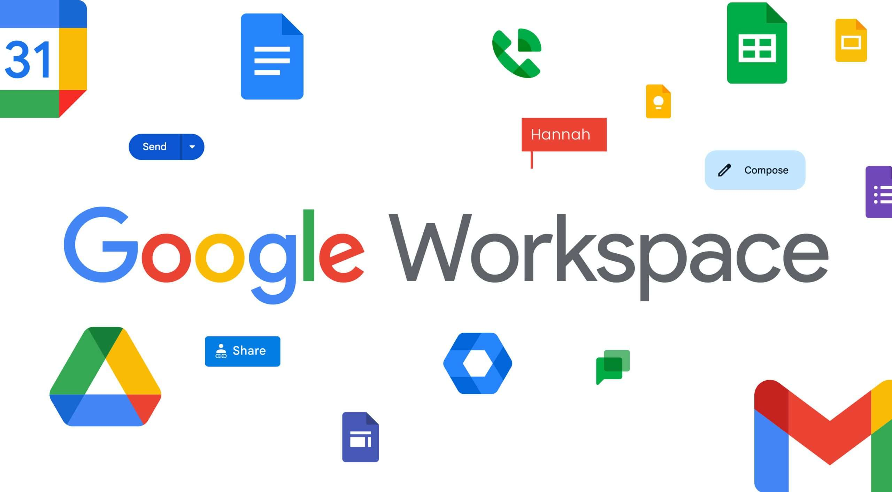
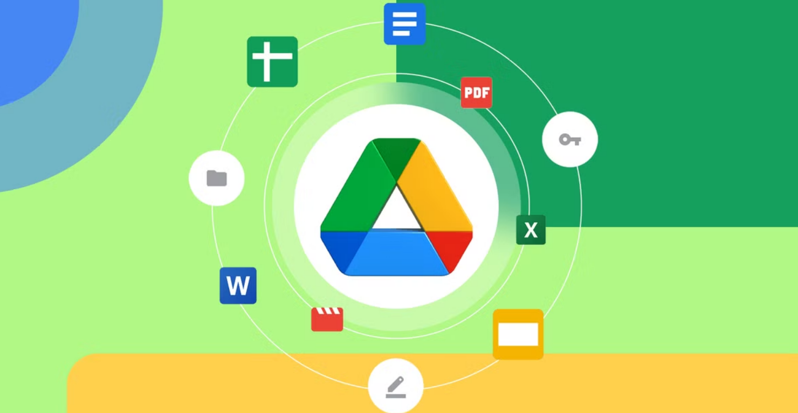

<h4><code>[●─── ⚙️ ─── SYS.ACT_04 // GOOGLE_WORKSPACE_&_DRIVE ─── ⚙️ ───●]</code></h4>
 

# ⚙️ ACT 4: PRESENTATION OF GOOGLE WORKSPACE ⚙️

<code>[●─── ⚙️ ─── ılıllılı ─── ⚙️ ───●]</code>

 

  Google Workspace, previously known as G Suite, is a cloud-based suite of productivity and collaboration tools. It allows teams to store files, manage communications, and work together efficiently from anywhere online.
  
  My group members and I were tasked to present one of the main tools in Google Workspace, which is Google Drive, so that everyone can learn how to easily organize files, share documents, and collaborate online. This activity details the definitions, connected apps, storage limits, and key features, and other details about Google Drive.

 

 

# ⚙️ GOOGLE DRIVE ⚙️

 

<code>[●─</code>&nbsp;&nbsp;

&nbsp;&nbsp;<code>─●]</code>

 

### ⚙️ SYS.SPEC // What? ⚙️

- It is a cloud storage and synchronization service developed by Google that allows users to store, share, synchronize, and edit files, folders, and other files that were made from Google.
- Google Drive was officially launched on April 24, 2012. It was made available on multiple platforms, including Windows, MacOS, Android, and a website interface. Shortly after its initial release, the iOS app was made available in June 2012.
- Google Drive reached over 2 billion monthly active users globally, held 7.43% market share in the file-sharing category, and generated 2.4 billion visits to drive.google.com.

 

### ⚙️ SYS.LOGIC // Purpose ⚙️

Google Drive is a cloud-based storage platform built to simplify digital management and collaboration. Its main purposes are:

| Purpose | Description |
| :--- | :--- |
| **File Organization** | To keep all your digital files neatly organized in one secure online space instead of cluttering your physical computer. |
| **Easy Sharing** | To send documents, photos, or folders to family, friends, or coworkers with just a few clicks. |
| **Teamwork** | To let multiple people work on the same project or document together at the same time. |

 

### ⚙️ SYS.INFO // Did you know? ⚙️

|
Keep Everything, Share Anything
|
| :--- |
|
The tagline for Google Drive, which means users can securely store all their files in one accessible storage and easily share individual files or entire folders with anyone. 
|

 

|
G Suite
|
| :--- |
|
Google Drive serves as a key component of G Suite, a monthly subscription plan offered by Google for businesses and organizations because it acts as the central hub where all files, documents, sheets, slides, and media are securely stored, organized, and synced in the cloud.
|

 

### ⚙️ SYS.MODULES // Features/Characteristics ⚙️

| Features | Explanation |
| :--- | :--- |
| **Storing files** | Users receive 15 GB of free space, shared among Gmail, Google Drive, and Google Photos. If they run out of storage, users can pay to upgrade to Google One for more storage. |
| **Sharing files** | A user's files stay private until they decide to share them. They can easily allow other people to view, edit, or download their documents. |
| **Accessing files from anywhere** | Users can open their files on any phone, tablet, or computer. They can even set files up to work offline. |
| **Secure storage** | Files are protected with strong encryption (AES256 or AES128), keeping them just as safe as a user's other Google accounts. |

 

### ⚙️ SYS.EVAL // Advantages and Disadvantages ⚙️

Here are the advantages and disadvantages of Google Drive:

| Advantages | Disadvantages |
| :--- | :--- |
| **Cloud-based access**  Google Drive lets users store, open, and share files from anywhere using an internet connection. | **Limited free storage**  The 15 GB of free storage can fill up fast because it is shared across Gmail, Photos, and Drive. |
| **Seamless integration with Google Workspace**  Users can collaborate on different types of content directly from a single platform. | **Privacy concerns**  Google scans stored files to check for malware and policy violations, raising privacy concerns for some users. |
| **15 GB of free storage**  Google Drive provides 15 GB of free storage shared across Google Drive, Gmail, and Google Photos. | **Internet dependency**  You need an internet connection to use Google Drive unless you turn on offline mode. |
| **File sharing and permissions**  People who own files or folders can easily share them and choose whether others can view, comment on, or edit them. | **File size limitations**  There is a daily upload limit of 750 GB per user for individual files. |
| **Cross-platform availability**  Google Drive can be used in web browsers, desktop apps, and mobile apps. | |

 

### ⚙️ SYS.NODES // Apps ⚙️

Google Drive provides shared storage for all files created and used within the Google Workspace.

Here are the websites, apps that can be appeared in Google Drive

- [Google Docs](https://drive.google.com/drive/my-drive?q=type:document%20parent:0AJ_OfS0EFKi2Uk9PVA)
- [Google Sheets](https://drive.google.com/drive/my-drive?q=type:spreadsheet%20parent:0AJ_OfS0EFKi2Uk9PVA)
- [Google Slides](https://drive.google.com/drive/my-drive?q=type:presentation%20parent:0AJ_OfS0EFKi2Uk9PVA)
- [Google Forms](https://drive.google.com/drive/my-drive?q=type:form%20parent:0AJ_OfS0EFKi2Uk9PVA)
- [Google Site](https://drive.google.com/drive/my-drive?q=type:site%20parent:0AJ_OfS0EFKi2Uk9PVA)
- [Google Videos](https://drive.google.com/drive/my-drive?q=type:vids%20parent:0AJ_OfS0EFKi2Uk9PVA)
- [Videos](https://drive.google.com/drive/my-drive?q=type:video%20parent:0AJ_OfS0EFKi2Uk9PVA)
- [Photo &amp; Images](https://drive.google.com/drive/my-drive?q=type:image%20parent:0AJ_OfS0EFKi2Uk9PVA)
- [Audio](https://drive.google.com/drive/my-drive?q=type:audio%20parent:0AJ_OfS0EFKi2Uk9PVA)
- [Drawings](https://drive.google.com/drive/my-drive?q=type:drawing%20parent:0AJ_OfS0EFKi2Uk9PVA)
- [PDFs](https://drive.google.com/drive/my-drive?q=type:pdf%20parent:0AJ_OfS0EFKi2Uk9PVA)
- [Archives (zip)](https://drive.google.com/drive/my-drive?q=type:archive%20parent:0AJ_OfS0EFKi2Uk9PVA)
- [Folders](https://drive.google.com/drive/my-drive?q=type:folder%20parent:0AJ_OfS0EFKi2Uk9PVA)

 

### ⚙️ SYS.CAPACITY // [Storage Spaces for Google Drive](https://one.google.com/intl/en_ph/about/#compare-plans) ⚙️

*(Click the title to see the Google One plans)*

➤ Google Drive serves as a key component of G Suite, which is Google's monthly subscription offering designed for businesses and organizations.

Since Google Drive is like a storage for files of any Google app, it offers a variety of memory spaces to store more files.

 

| Name | Bytes (Space) | Price |
| :--- | :--- | :--- |
| **Free of charge** | 15 GB | Free |
| **Lite** | 30 GB | ₱49 |
| **Basic** | 100 GB | ₱119 |
| **Standard** | 200 GB | ₱179 |
| **Google AI Plus** | 400 GB | ₱285 |
| **Google AI Pro** | 5 TB | ₱1,100 |
| **Google AI Ultra 5x** | 20 TB | ₱5,999 |
| **Google AI Ultra 20x** | 30 TB | ₱11,900 |

 

### ⚙️ SYS.EXTRAS // Additional Information About Google Drive ⚙️

 

#### Version History

| Explanation | Example |
| :--- | :--- |
| 
Another useful feature of Google Drive is Version History. This allows users to see the changes that were made to a file and, for supported files, go back to an earlier version.
 | 
For example, if we're working on a group report and someone accidentally changes or removes an important part, we can check the previous version of the document. This can be very helpful, especially.
 |

 

#### File Recovery

| Explanation | Example |
| :--- | :--- |
| 
When we accidentally delete a file, it doesn't immediately disappear permanently. Deleted files can be moved to the Trash, where they may still be restored within the available retention period.
 | 
For example, if we accidentally delete an important school requirement, we can check the Trash and restore the file if it is still available.
 |

 

#### Search Function

| Explanation | Example |
| :--- | :--- |
| 
If we have a lot of files saved in Google Drive, finding a specific document manually can be time-consuming. Google Drive has a search function that allows users to quickly look for files.
 | 
For example, instead of opening different folders one by one to find a research paper, we can simply type the name or keywords of the file in the search bar. This makes managing a large number of files much easier.
 |

 

#### File Sharing Through Links

| Explanation | Example |
| :--- | :--- |
| 
Aside from directly sharing a file with a specific person, Google Drive also allows users to share files through a link. When creating a link, the owner can control the access of other people.
 | 
For example, we can set the file so that someone can only view it, comment on it, or edit it. So before sharing a link, it's important to check the permission settings to make sure that only the intended people can access or change the file.
 |

<h4><code>[●─── ⚙️ ─── ılıllılı ─── 🎮 ─── ■▶]</code></h4>

 

 
 
<code>◀■</code>&nbsp;

&nbsp;
&nbsp;&nbsp;&nbsp;&nbsp;
&nbsp;

&nbsp;
&nbsp;&nbsp;&nbsp;&nbsp;
&nbsp;

&nbsp;<code>───●]</code>

