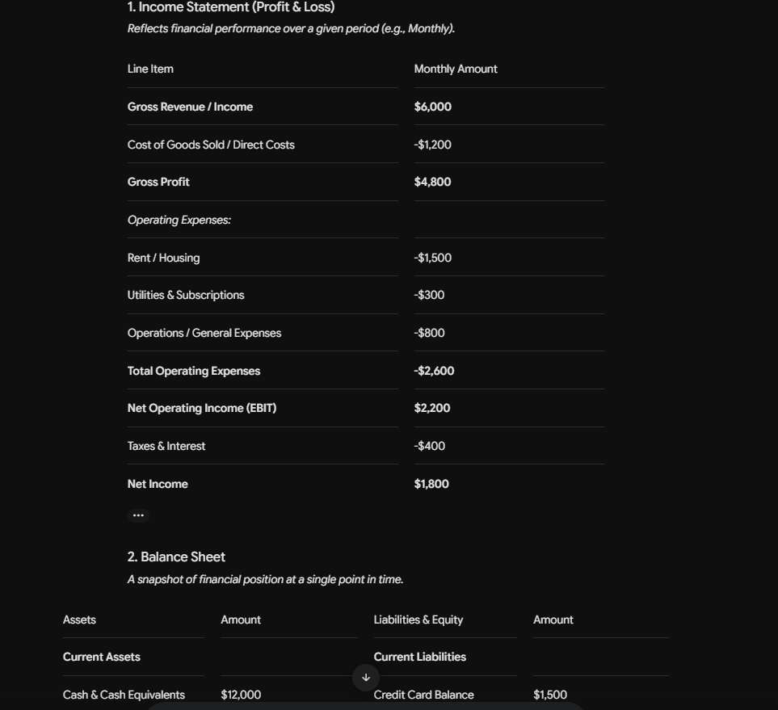
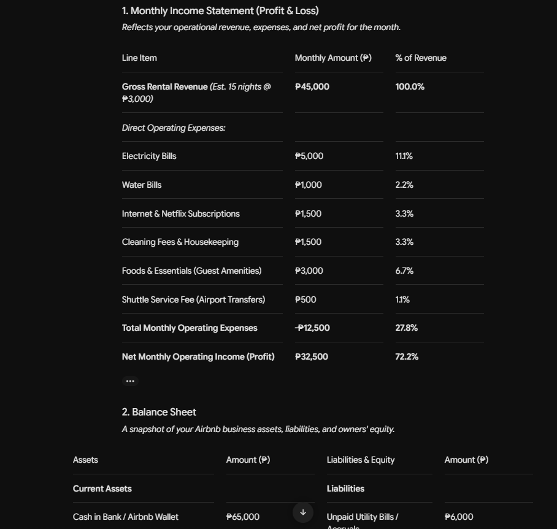

<h4><code>[●─── ⚙️ ─── SYS.ACT_05 // ARTIFICIAL_INTELLIGENCE_&_PROMPT_ENGINEERING ─── ⚙️ ───●]</code></h4>

 

# ⚙️ Artificial Intelligence ⚙️

<code>[●─── ⚙️ ─── ılıllılı ─── ⚙️ ───●]</code>

 

  Artificial Intelligence is computer systems or software designed to perform tasks that normally require human intelligence, such as reasoning, generating text, and analyzing information. This tool helps people work faster and generate ideas, making their daily tasks or projects easier. AI can give responses that either satisfy you or miss what you actually want, so you need to keep asking more questions to refine and get closer to what you need. AI may give you either clear or unclear answers, depending on whether AI understands or misunderstands your thoughts. Sometimes, we may think that AI gives incorrect or misleading answers, which can leave us feeling dissatisfied. Or maybe it is your prompt or description that lacks details or is too short, which can make AI generate responses that are not clear or connected to your perspective.

 

 

<code>[●─── MODULE 05 // PROMPT COMPARISON &amp; AI OUTPUT ANALYSIS ───●]</code>

# ⚙️ ACT 5: PRESENTATION OF GOOGLE WORKSPACE ⚙️

 

In this activity, we tested the AI by giving vague and specified prompt. After that, we compared the differences between those prompts.

 

<code>[●─</code>&nbsp;&nbsp;

&nbsp;&nbsp;&nbsp;&nbsp;

&nbsp;&nbsp;<code>─●]</code>

 

### ⚙️ SYS.COMPARE // PROMPT EVALUATION TABLE ⚙️

<table>
  <tr>
    <th align="center"></th>
    <th align="center">⚙️ SYS // General</th>
    <th align="center">⚙️ SYS // Specified</th>
  </tr>
  <tr>
    <td align="left"><b>Prompt</b></td>
    <td align="left">“make me financial statements (balance sheet, income statement, and cash flow)”</td>
    <td align="left">
      imagine that you are the owner and the one who manage an airbnb house. Make me financial statements about it. 
      Here are the details: (monthly; in pesos) 
      • electricity bills = 5,000 
      • Water bills = 1000 
      • Internet and Netflix fee = 1,500 
      • Cleaning fee = 1500 
      • Shuttle fee (from and to airport) = 500 
      • Foods and essentials = 3000
    </td>
  </tr>
  <tr>
    <td align="left"><b>Results</b></td>
    <td align="center"></td>
    <td align="center"></td>
  </tr>
  <tr>
    <td align="left"><b>Observation</b></td>
    <td align="left">
      • Prompt too broad; no details. 
      • Made-up/guessed numbers + default currency. 
      • Good to see how reports connect, but not for real tracking.
    </td>
    <td align="left">
      • Detailed prompt: exact bills, pesos (₱), Airbnb owner/manager context. 
      • Generic template turned into custom report with real numbers. 
      • Clear details upfront = more accurate, useful AI output.
    </td>
  </tr>
</table>

 
<!-- ==================== INLINE NAVIGATION FOOTER (PREV: ACT 05 / MAIN PORTFOLIO / NEXT: ACT 06) ==================== -->

<code>[●─</code>&nbsp;

&nbsp;
&nbsp;&nbsp;&nbsp;&nbsp;
&nbsp;

&nbsp;
&nbsp;&nbsp;&nbsp;&nbsp;
&nbsp;

&nbsp;<code>■▶</code>

<h4><code>[●─── ⚙️ ─── ılıllılı ─── 🎮]</code></h4>

