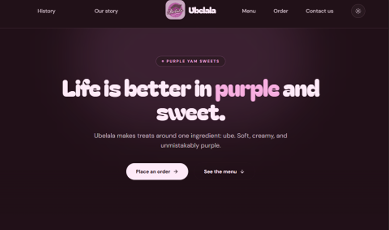

<h4><code>【◄ 🎮 STAGE_06 // WEB_CREATION_WITH_AI ►】</code></h4>

 

# 🎮 ACT 6: MAKING A WEBSITE 🎮

<code>【◄ 🎮 ─── ılıllılı ─── 🕹️ ►】</code>

 

  These days, a website is useful for visibility, especially for businesses, advocacies, and more. It is one of the tools used to promote, advertise, and attract more people. However, building a website is quite time-consuming, requires a larger budget, and needs someone to manage the site. There are many ways to create a website, and AI is a newer tool people can use. In this activity, we decided on the website concept, wrote a specific prompt with clear details, and designed the website using AI tools.

 

<code>【◄</code>&nbsp;&nbsp;

&nbsp;&nbsp;<code>►】</code>

 

<code>【◄</code>&nbsp;

&nbsp;

&nbsp;

&nbsp;<code>►】</code>

 

### 🎮 QUEST_LOG // UBELALA OVERVIEW 🎮

<table>
  <tr>
    <th align="center">🎮 CATEGORY</th>
    <th align="center">🕹️ DETAILS</th>
  </tr>
  <tr>
    <td align="left"><b>Concept</b></td>
    <td align="left">Business Idea – Ubelala</td>
  </tr>
  <tr>
    <td align="left"><b>Objectives</b></td>
    <td align="left">
      • Promote and elevate local Filipino ube. 
      • Showcase the menu products with ingredient list, description, and picture. 
      • Contact for order or feedback
    </td>
  </tr>
  </table>

 

### 🎮 GAMEPLAY_PREVIEW // WEBSITE 🎮

 

 

### 🎮 BUILD_WALKTHROUGH // HOW &amp; REFLECTION 🎮

 

<table>
  <tr>
    <th align="center">🎮 HOW</th>
    <th align="center">🕹️ REFLECTION</th>
  </tr>
  <tr>
    <td align="left">
      • Describe the Ubelala one-page site instead of coding it manually. 
      • Start with the logo and basic idea, then build section by section (ube history, story, menu, order form, contact). 
      • Give specific brand details, such as order, colors, fonts, and exact wording. Then either provide them or ask the AI to include ingredient lists and pictures. 
      • Refine the first draft—center the opening text, align the logo in the menu bar, add a slide-in animation, and insert food photos. 
      • Double-check accuracy, ingredients, and photo rights yourself. 
      • Compile everything into a reusable final prompt.
    </td>
    <td align="left">
      • Creating a website is quite hard because you need to design it to be visually appealing, accessible, functional, and error-free so people can use it. 
      • Even when using AI, we just need to provide details and such, though sometimes our prompt isn't enough. 
      • Sometimes we need to keep asking for details and functions to change, and AI may or may not follow what is in your thoughts.
    </td>
  </tr>
</table>

 

<!-- ==================== INLINE NAVIGATION FOOTER (PREV: ACT 05 / MAIN PORTFOLIO / NEXT: ACT 07) ==================== -->

<code>【◄</code>&nbsp;

&nbsp;<code>►】</code>
&nbsp;&nbsp;&nbsp;&nbsp;
<code>【◄</code>&nbsp;

&nbsp;<code>►】</code>
&nbsp;&nbsp;&nbsp;&nbsp;
<code>【◄</code>&nbsp;

&nbsp;<code>►】</code>

 

<h4><code>【◄ 🎮 ─── ılıllılı ─── 🕹️ ►】</code></h4>

