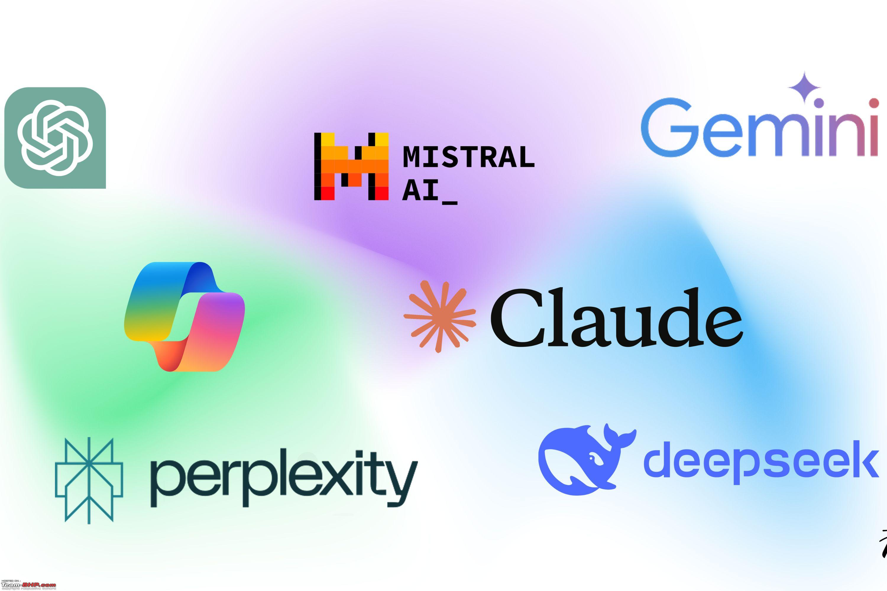
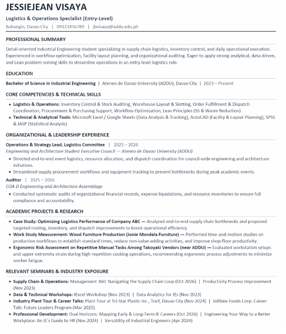
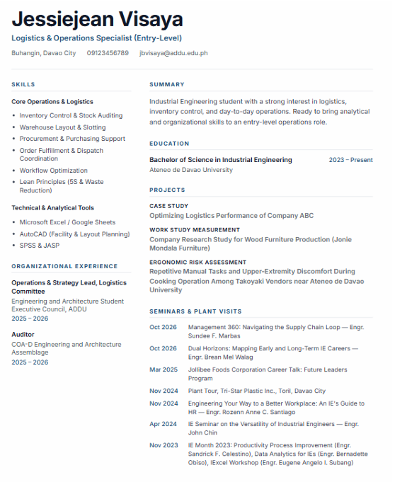
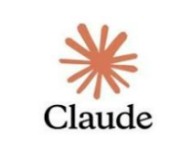
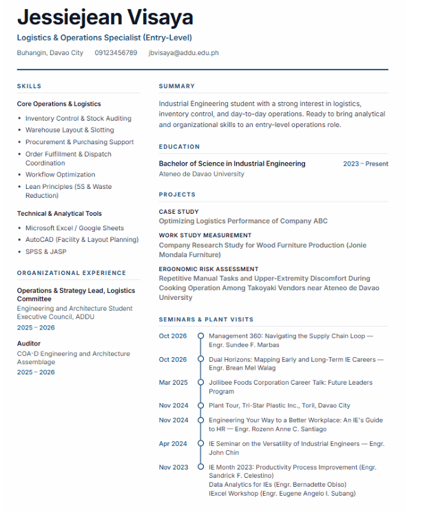

<h4><code>【◄ 📼 MIXTAPE_07 // UNDERSTANDING_AI_LLMS_&_OUTPUTS ►】</code></h4>

 

 

# 📼 UNDERSTANDING AI LLMS &amp; OUTPUTS 📼

<code>【◄ ⏺ ─── [ ◎ ══════ ◎ ] ─── ⏏ ►】</code>

  More and more AI tools are being developed today, and many share the same core concept while producing different outputs. A clear example of this is AI chatbots like ChatGPT, Gemini, and Claude. These chatbots share the same main function, which is answering questions and generating text, yet they deliver different results and layouts. Even when given the same prompt, one tool might give a detailed, structured explanation while another offers a shorter, more conversational response. Because each AI is trained differently and has its own strengths, comparing their outputs helps users pick the best result for their specific needs.

 

 

# 🎶 ACT 7: RESUME GENERATING USING DIFFERENT LLMS 🎶

<code>【◄ ⏪ ─── [ ◎ ══════ ◎ ] ─── ⏩ ►】</code>

 

  A resume is essential for us, especially when looking for jobs, as it helps companies evaluate our qualifications and fit for a role. It showcases our personal details, traits, skills, experiences, and more. Resumes come in different formats, and there are many ways to create one, such as using Canva templates or resume-builder websites. AI tools are also one of the options that make creating a resume easier and quicker. In this activity, we were tasked with creating a resume using different AI Large Language Models (LLMs). We provided details and descriptions for the layout and quality of the resume we expected. This activity showed that, despite sharing the same concept, these AI tools can produce different outputs based on how they interpret your prompt.

 

<code>【◄</code>&nbsp;&nbsp;

&nbsp;&nbsp;<code>►】</code>

  

#### <code>【◄ 📻 AI LLMS TOOLS USED ►】</code>

<code>【◄</code>&nbsp;

&nbsp;

&nbsp;<code>►】</code>

 

#### <code>【◄ ▶️ PROMPT / PROOF ►】</code>

<code>【◄</code>&nbsp;

&nbsp;<code>►】</code>
&nbsp;&nbsp;&nbsp;&nbsp;
<code>【◄</code>&nbsp;

&nbsp;<code>►】</code>

 

### 📼 TAPE_PLAYBACK // GENERATED RESUME RESULTS 📼

<code>【◄ ⏪ ─── [ ◎ ══════ ◎ ] ─── ⏩ ►】</code>

 

<table>
  <tr>
    <th align="center">📼 SIDE A // GEMINI OUTPUT</th>
    <th align="center">📼 SIDE B // CLAUDE OUTPUT</th>
  </tr>
  <tr>
    <td align="center"></td>
    <td align="center"></td>
  </tr>
</table>

 

### 🎚️ DECK_CHECK // GEMINI VS. CLAUDE COMPARISON 🎚️

<code>【◄ ⏺ ─── [ ◎ ══════ ◎ ] ─── ⏏ ►】</code>

 

<table>
  <tr>
    <th align="center">📻 CRITERIA</th>
    <th align="center">📼 TRACK 01: GEMINI</th>
    <th align="center">📼 TRACK 02: CLAUDE</th>
  </tr>
  <tr>
    <td align="left"><b>Structure</b></td>
    <td align="left">
      • Uses a single column stacked straight down from top to bottom. 
      • Follows a classic resume layout that is easy to read from start to finish. 
      • Each section stretches across the page in a single straight flow.
    </td>
    <td align="left">
      • Uses a two-column layout with a narrower left side and a wider right side. 
      • Places skills and club roles on the left, and school, projects, and seminars on the right. 
      • Balances space nicely with a side-by-side arrangement.
    </td>
  </tr>
  <tr>
    <td align="left"><b>Organization</b></td>
    <td align="left">
      • Groups items into categories with key titles and highlights. 
      • Packs too many details into the same lines, making it look a bit cluttered. 
      • Harder to tell at a glance where one item ends and the next begins.
    </td>
    <td align="left">
      • Organizes pasted information neatly by category and date. 
      • Lists each skill on its own line and aligns dates cleanly on the left. 
      • Keeps the layout tidy so specific dates and skills are easy to spot right away.
    </td>
  </tr>
  <tr>
    <td align="left"><b>Format</b></td>
    <td align="left">
      • Uses a tightly packed layout that squeezes many words onto the page with minimal white space. 
      • Relies on plain black text, bold titles, and thin border lines to separate sections. 
      • Gives off a traditional, standard school- or office-document feel.
    </td>
    <td align="left">
      • Uses an open, modern layout with generous white space and clean blue accents. 
      • Features large, clear section titles, though the border lines look slightly faint. 
      • Looks like a fresh, stylish, and well-organized template overall.
    </td>
  </tr>
  <tr>
    <td align="left"><b>Readability</b></td>
    <td align="left">
      • Looks somewhat messy and cramped due to wordy, tightly packed text. 
      • Thick text blocks reduce readability and make quick scanning difficult. 
      • May discourage busy recruiters from reading the entire page or accepting the resume.
    </td>
    <td align="left">
      • Highly readable and straightforward thanks to generous white space and short lines. 
      • Allows the eyes to move smoothly down the page without feeling overwhelmed by text. 
      • Enables recruiters to scan the page and grasp the main points right away.
    </td>
  </tr>
  <tr>
    <td align="left"><b>Quality</b></td>
    <td align="left">
      • Provides clear, helpful explanations for roles and projects. 
      • Explains what you actually did and how it helped instead of just listing names. 
      • Gives employers concrete proof of your hard work and skills.
    </td>
    <td align="left">
      • Lacks explanations in some sections since it mostly pasted and arranged your info. 
      • Lists titles and dates of roles and projects without detailing actual tasks or results. 
      • Shows employers what you joined, but not what you actually achieved.
    </td>
  </tr>
</table>

 

### 📝 CASSETTE_J-CARD // OBSERVATION 📝

<code>【◄ 🎶 ─── [ ◎ ══════ ◎ ] ─── 🎶 ►】</code>

 

- Tested Gemini and Claude AI using the same resume prompt, showing that each AI model has its own unique design style, approach, and strengths.
- Learned that a great resume needs a balance between strong content and a clean layout.
- **Gemini** gave detailed, helpful explanations of skills and projects, though packing too many words onto the page made it look cluttered.
- **Claude AI** produced a neat, organized, and visually pleasing layout, even though it left out some details about actual accomplishments.
- Realized that writing a clear, complete, and well-structured prompt is key to getting strong results without needing extra revisions.
- Chose **Claude AI** overall as the better tool for resume creation because of its clean, neat, and straightforward layout.

 

### 🏆 TOP_TRACK // FINAL OUTPUT 🏆

<code>【◄ ▶️ ─── [ ◎ ══════ ◎ ] ─── ⏹ ►】</code>

 

<table>
  <tr>
    <th align="center">📻 FINAL SELECTION</th>
    <th align="center">📼 SELECTED RESUME RESULT</th>
  </tr>
  <tr>
    <td align="center" valign="middle">
      
        
      <b>AI Used:</b>  
      <code>【◄</code>&nbsp;
      
      &nbsp;<code>►】</code>
    </td>
    <td align="center"></td>
  </tr>
</table>

 

<!-- ==================== INLINE NAVIGATION FOOTER (PREV: ACT 06 / MAIN PORTFOLIO) ==================== -->

<code>【◄</code>&nbsp;

&nbsp;<code>►】</code>
&nbsp;&nbsp;&nbsp;&nbsp;
<code>【◄</code>&nbsp;

&nbsp;<code>►】</code>

<h4><code>【◄ ⏺ ─── [ ◎ ══════ ◎ ] ─── ⏏ ►】</code></h4>

