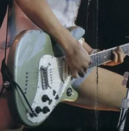
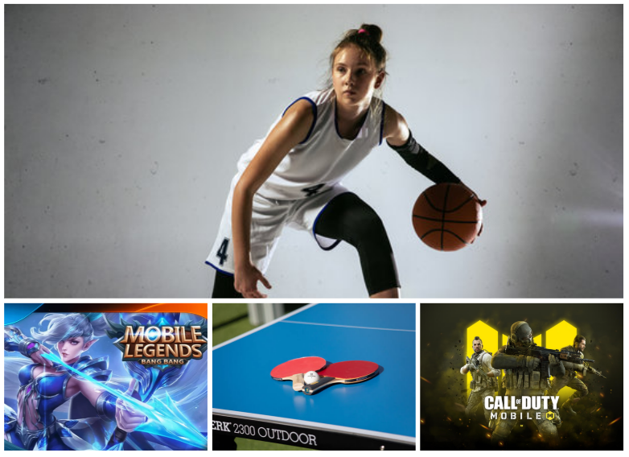
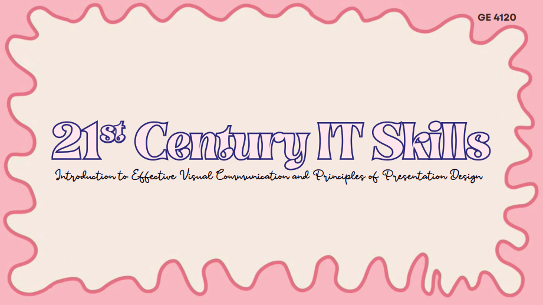
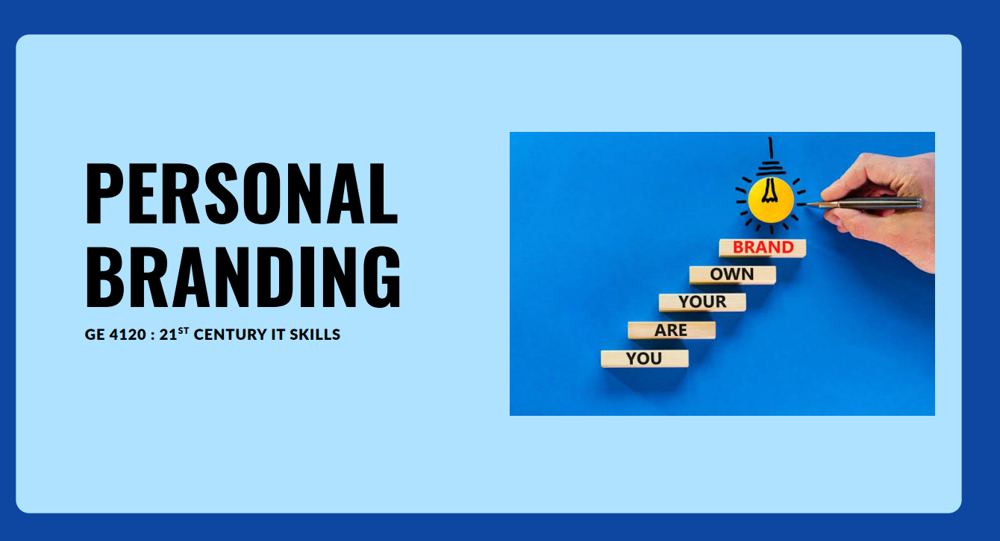
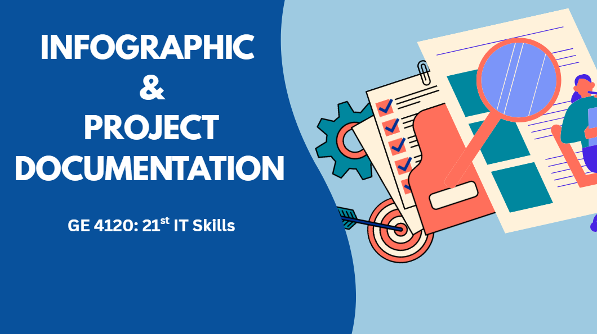
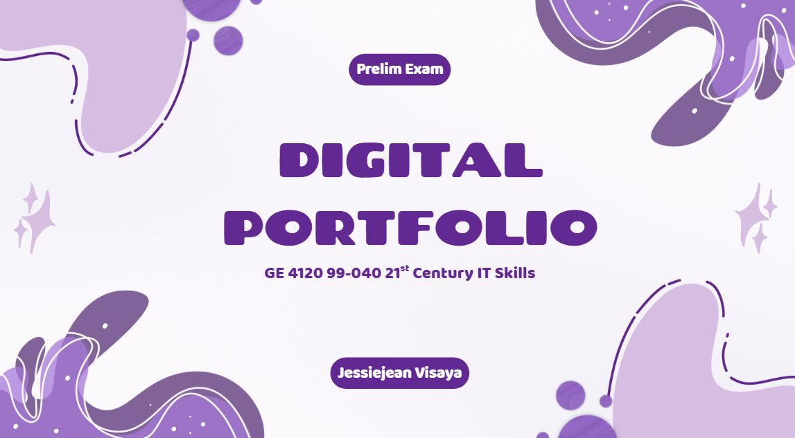
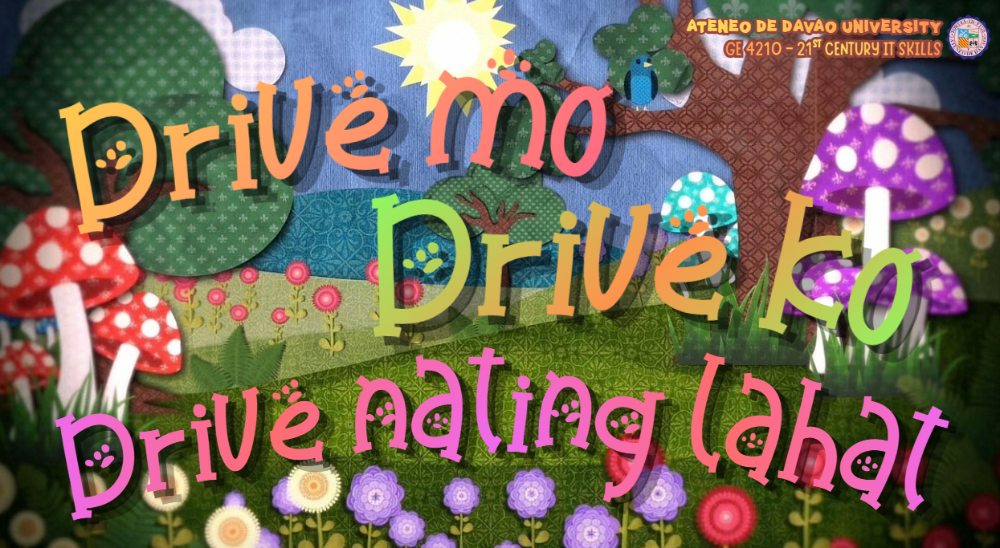
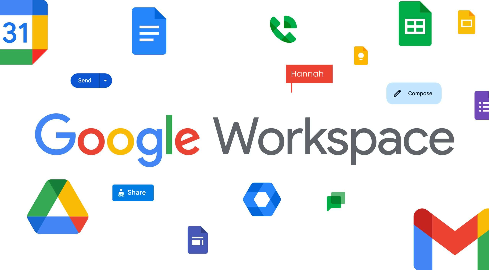
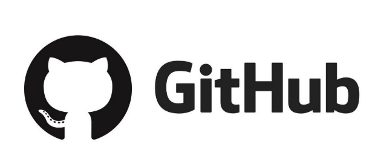

# ⚡⚙️ 21ST CENTURY IT SKILLS ⚙️⚡

*✨ Journey &amp; Activities in 21st Century IT skills (Digital Portfolio) ✨*

`₊˚◈ ───────── ılıllılı ───────── ◈˚₊`

 

<!-- TABLE 1: 3-Column Picture & Music Waves Banner -->

<table>
  <tr>
    <td width="30%" align="center" valign="middle">
      
        
      <code>ılılıll|̲̅̅●̲̅̅|̲̅̅=̲̅̅|̲̅̅●̲̅̅|llılılı</code>
        
      
        
      <code>◄◄⠀▐▐ ⠀►►</code>
       
      <code>01:24 ───●───── 03:45</code>
    </td>
    <td width="40%" align="center" valign="middle">
      
        
      
       
      <b>ılılıll JESSIEJEAN VISAYA llılılı</b>
    </td>
    <td width="30%" align="center" valign="middle">
      
        
      <code>ılılıll|̲̅̅●̲̅̅|̲̅̅=̲̅̅|̲̅̅●̲̅̅|llılılı</code>
        
      
        
      <code>◄◄⠀▐▐ ⠀►►</code>
       
      <code>VOLUME: ████████░░ 80%</code>
    </td>
  </tr>
</table>

 

<!-- TABLE 2: Full-Width Personal Info Card -->

<table>
  <tr>
    <td colspan="2" width="100%" valign="top">
      <h3 align="center">⚙️ Hey there! I'm Jessiejean Visaya ⚙️</h3>
      

        You can call me <b>JJ</b>! I am a <b>3rd</b> <b>Bachelor of Science in Industrial Engineering</b> student from <b>3A</b> at <b>Ateneo de Davao University</b>. Being in a program that combines engineering, business, and technology, this subject helps me learn more about <b>digital tools and tech skills</b> that I can use in the future. Here you can find my coursework and activities for the semester.
      

    </td>
  </tr>
  <tr>
    <td width="50%" valign="top">
      <ul>
        <li><b>Program:</b> Bachelor of Science in Industrial Engineering (3A)</li>
        <li><b>University:</b> Ateneo de Davao University</li>
      </ul>
    </td>
    <td width="50%" valign="top">
      <ul>
        <li><b>Course:</b> 99-040 GE 4120: 21st Century IT Skills</li>
        <li><b>Motto:</b> "Don't Give Up and Keep Going!"</li>
      </ul>
    </td>
  </tr>
  <tr>
    <td colspan="2" width="100%" align="center" valign="middle">
       
      
      
      
       
      
    </td>
  </tr>
</table>

 

### 🎛️ ₊˚◈ About the Portfolio ◈˚₊ 🎛️

`••• ılıllılı •••`

> **🔊** *Welcome to JJ’s Repository! This is a collection of my activities for 21st Century Skills in Prelim. It shows what I learned from our discussions by applying the lessons to real outputs. The repository highlights three main activities: presentation design principles, personal branding, and social media infographics with project documentation. Together, these outputs show my overall progress and understanding of 21st-century IT skills.*

`─── ⚙️ ─── 🎧 ─── 🎮 ───`

 

## 🦾 ₊˚◈ Journey &amp; Activities ◈˚₊ 📑

`••• ─── ılıllılı ─── •••`

### ⚡ ✨ Prelim Period ✨ ⚡

<table>
  <tr>
    <td width="33%" align="center" valign="middle">
       
      <b>⚙️ Activity 1 ⚙️</b>
        
      
        
      <b>PRESENTATION DESIGN PRINCIPLES</b>
        
    </td>
    <td width="33%" align="center" valign="middle">
       
      <b>🎧 Activity 2 🎧</b>
        
      
        
      <b>PERSONAL BRANDING</b>
        
    </td>
    <td width="33%" align="center" valign="middle">
       
      <b>🎮 Activity 3 🎮</b>
        
      
        
      <b>SOCIAL MEDIA INFOGRAPHICS & PROJECT DOCUMENTATION</b>
        
    </td>
  </tr>
  <tr>
    <td align="center" valign="middle">
      
    </td>
    <td align="center" valign="middle">
      
    </td>
    <td align="center" valign="middle">
      
    </td>
  </tr>
</table>

  
<table>
  <tr>
    <td width="32%" align="center" valign="middle">
      
    </td>
    <td width="68%" align="center" valign="middle">
      <h3>🎧 PRELIM EXAM_VISAYA 🎧</h3>
      

        A walkthrough of how I built my prelim portfolio and GitHub repository layout, covering the tools, templates, and design elements used in my prelim activities. Watch the video for the full breakdown.
      

       
      <code>─── ılıllılı ───</code>
        
      <code>◄◄</code>&nbsp;&nbsp;
      
      &nbsp;&nbsp;<code>►►</code>
     
       
    </td>
  </tr>
</table>

`[●─── ⚙️ ─── ılıllılı ─── ⚙️ ───●]`

 

### ⚙️ ✨ Midterm Period // SYS.MIDTERM ✨ ⚙️

 

<table>
  <tr>
    <td width="50%" align="center" valign="top">
       
      <code>─── ⚙️ SYS.REPORT // GROUP 03 ───</code>
      <h3>🛠️ Face-to-Face Class Reporting 🛠️</h3>
      
        
      

        Our Group 3 in-class report on how Google Drive works and how to use it effectively. These slides cover the key features and other details we presented to the class. Click the button below to view our presentation on Canva.
      

       
      <code>[●─── ılıllılı ───●]</code>
        
      <code>[●─</code>&nbsp;&nbsp;
      
      &nbsp;&nbsp;<code>─●]</code>
        
    </td>
    <td width="50%" align="center" valign="top">
       
      <code>─── 🎮 STAGE.02 // LAB_QUEST ───</code>
      <h3>🕹️ Midterm Laboratory Examination 🕹️</h3>
      
        
      

        A hands-on practical laboratory exam applying the Google Workspace skills we learned from each group's class reports. This folder contains all of my completed lab outputs. Click the button below to view my work on Google Drive.
      

       
      <code>◀ ■ ─── ılıllılı ─── ■ ▶</code>
        
      <code>◀ ■</code>&nbsp;&nbsp;
      
      &nbsp;&nbsp;<code>■ ▶</code>
        
    </td>
  </tr>
</table>

`[●─── ⚙️ ─── ılıllılı ─── ◀■ ───●]`

 

### ⚙️ ✨ Prefinals Period ✨ 🎮

 

<table>
  <tr>
    <td width="33%" align="center" valign="top">
       
      <code>─── ⚙️ SYS.05 ───</code>
        
      <b>🤖 Activity 5 🤖</b>
        
      
        
      <b>AI Tools &amp; Prompt Engineering</b>
        
    </td>
    <td width="33%" align="center" valign="top">
       
      <code>─── 🎧 TRACK.06 ───</code>
        
      <b>🌐 Activity 6 🌐</b>
        
      
        
      <b>AI-Assisted Website Creation</b>
        
    </td>
    <td width="33%" align="center" valign="top">
       
      <code>─── 🎮 STAGE.07 ───</code>
        
      <b>📄 Activity 7 📄</b>
        
      
        
      <b>AI-Powered Resume Generation</b>
       
    </td>
  </tr>
  <tr>
    <td align="center" valign="middle">
       
     &nbsp;&nbsp;
      
      &nbsp;&nbsp;
        
    </td>
    <td align="center" valign="middle">
       
      &nbsp;&nbsp;
      
      &nbsp;&nbsp;
        
    </td>
    <td align="center" valign="middle">
       
      &nbsp;&nbsp;
      
      &nbsp;&nbsp;
        
    </td>
  </tr>
</table>

 

 
 
<table>
  <tr>
    <td width="100%" align="center" valign="middle">
       
      <code>─── ⚙️ SYS.FINAL_BUILD // PORTFOLIO ───</code>
      <h3>🖥️ Prefinal Examination: GitHub Repository Enhancement 🖥️</h3>
      
        
      

    Upgrading, organizing, and redesigning this GitHub repository into a cohesive, aesthetic, and well-structured digital portfolio.
  

       
      <code>[●─── ılıllılı ───●]</code>
        
     <code>[●─</code>&nbsp;&nbsp;
      
      &nbsp;&nbsp;<code>─●]</code>
       
    </td>
  </tr>
</table>

`◄◄ ─── ılıllılı ─── ►►`

 

### 🎧 ✨ Course Reflection &amp; Gratitude ✨ 🎧

 

<table>
  <tr>
    <td width="66%" align="left" valign="middle">
       
      

        <code>─── 🎧 TRACK.OUTRO // REFLECTION ───</code>
        <h3>🎶 A Little Note &amp; Reflection 🎶</h3>
      

      

        [Write your course reflection, key takeaways, and gratitude note here.]
      

      

        [Add a second paragraph reflecting on how these tools and workflows connect to your engineering and project work.]
      

      

        [Add your thank-you note to your instructor/classmates here.]
      

       
      

        <i>Sincerely,</i> 
        <b>[Your Name]</b>
      

       
    </td>
    <td width="34%" align="center" valign="middle">
       
      
        
      <b>🎧 [Your Name / Artist Tag] 🎧</b>
       
      <code>ılılıll|̲̅̅●̲̅̅|̲̅̅=̲̅̅|̲̅̅●̲̅̅|llılılı</code>
       
        
      <code>◄◄</code>&nbsp;&nbsp;&nbsp;&nbsp;<code>►►</code>
      </a>
        
    </td>
  </tr>
</table>
`◄◄ ─── ılıllılı ─── ►►`
  

 
<b>Thank you for visiting! 🎧 ✨</b>

